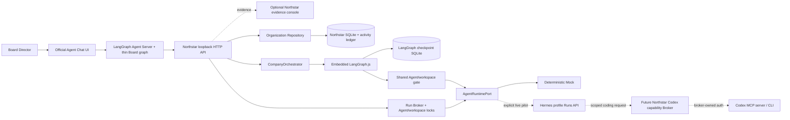
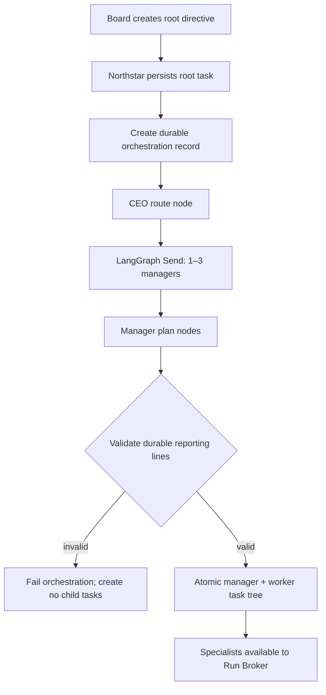

# Architecture

## Product model

The Board interacts with one company chat, not 16 chat boxes. Agents are durable organizational identities; tasks, Runs, decisions, and evidence are the coordination medium. Model sessions and chat threads are temporary compute/context.



The three live layers have deliberately different jobs:

| Layer | Owns | Must not own |
| --- | --- | --- |
| Northstar | Company identity, reporting lines, tasks, Runs, locks, approvals, audit and evidence | Model reasoning or a chat-centric identity model |
| LangGraph.js | The resumable route for one company directive | Permanent employees, long-term memory or final business truth |
| Hermes Agent | A profile's reasoning loop, model, skills, tools and later memory | Organizational authority, task ownership or Codex credentials |

## Why a modular monolith

Northstar remains one local TypeScript repository with a React app, Node API, shared domain package, and SQLite. LangGraph is embedded as a library. The difficult problem is ownership, permissions, evidence, and recovery—not distributed messaging. Hermes remains behind a small HTTP adapter so it can later run on the same Mac, in containers, or on Ubuntu without changing the domain model.

| Layer | Responsibility |
| --- | --- |
| `packages/core` | Domain contracts and workflow invariants |
| `apps/server/api` | Local HTTP boundary and runtime input/origin checks |
| `apps/server/application` | Company graph, Run queueing, concurrency and locking |
| `apps/server/infrastructure` | Northstar persistence, LangGraph checkpointer, Hermes/Codex adapters |
| Official Agent Chat UI | Primary Board conversation surface; no organizational authority |
| `apps/web` | Optional evidence and administration views |

## Core invariants

1. The Board owns intent and irreversible authority.
2. Every task has one accountable owner and may have one independent reviewer.
3. Hierarchy governs responsibility and routing without forcing every task through every layer.
4. An Agent identity belongs to Northstar. LangGraph `thread_id`, Hermes `run_id`, and Codex `threadId` never become the Agent.
5. A task and an Agent each have at most one active Run; a writable workspace has one writer.
6. Green work without a reviewer may finish; yellow/reviewer work stops at review; red work stops at Board approval.
7. Approval records authority. A separate scoped capability gateway must execute any external action.
8. All Codex work goes through the Northstar Broker; Hermes never receives Codex auth or a raw unrestricted Codex tool.

## Current company-planning flow



The graph currently covers routing and planning. A company-wide Mock directive produces three manager tasks and twelve specialist tasks; a department directive produces one manager task and four specialist tasks. Repeating the same orchestration is idempotent at the Northstar record/task-tree boundary.

The primary chat entry adds one transport layer before this flow:

```text
Agent Chat UI -> Board messages graph -> POST /api/board/turns -> durable root task -> CompanyOrchestrator
```

The Board graph never opens organization SQLite or constructs a second CompanyOrchestrator. It calls the loopback Northstar API, which remains the single durable writer. Northstar stores a request hash and a unique `(thread_id, message_id)` mapping so a retry cannot duplicate a directive or silently reuse the same message identity with changed content. The deterministic Avery reply is reconstructed from the durable company plan; it is not a second business source of truth.

The next graph stages are worker fan-out, evidence collection, manager synthesis, reviewer Runs, policy gates, and resumable Board interrupts. They are intentionally not represented as completed capabilities yet.

## Persistence boundaries

Northstar uses `.data/organization.sqlite` as the business source of truth. The embedded company graph uses a separate `.data/langgraph-checkpoints.sqlite` file and sets:

```text
thread_id = orchestration.langGraphThreadId
```

The local Agent Server separately owns temporary Board conversation checkpoints. Neither chat `thread_id` nor a chat message becomes an Agent identity. Checkpoints may contain routing state and IDs, but not OAuth tokens, raw secrets, large artifacts, or the only copy of a business decision. Hermes Run state is held by its Gateway and can disappear on restart; Northstar persists the corresponding durable Run and evidence. These persistence domains are intentionally not merged.

## Runtime and Run Broker boundary

Both graph planning and specialist execution pass through one shared Agent/workspace gate and then the same `AgentRuntimePort`. The gate prevents two concurrent executions for one employee and serializes writable work aimed at the same workspace. The current runtime implementations are:

- `MockAgentRuntime`: deterministic JSON routing/planning and safe execution summaries; no external calls.
- `HermesAgentRuntime`: guarded adapter over `POST/GET/stop /v1/runs`; live only when explicitly configured.

Specialist tasks enter the `RunBroker`, which enforces global concurrency, one active Run per Agent, and one writable Run per workspace. LangGraph nodes do not bypass this broker for specialist work. Hermes approval waits trigger a stop request and an error; they are never converted into an automatic approval.

For the pinned Hermes commit, the first live deployment uses one dedicated loopback Gateway/port/key per profile and the normal `/v1/runs` path. Profile-prefixed multiplex Runs routes remain opt-in and unverified.

## Codex boundary

Codex is a future scoped engineering capability, not the default employee runtime. The repository retains a defensive Codex CLI adapter as reference, but this milestone does not wire Hermes to it.

The allowed future path is `Hermes -> Northstar capability -> Codex Broker -> codex mcp-server or codex exec --json`. The Broker owns the OS login, workspace policy, queue, and exact thread mapping. A ChatGPT OAuth login is shared identity/usage, not 16 credentials, and should initially have one serialized runner stream.

## Known limitations

- Hermes profiles, model-provider credentials, and a real Gateway have not been provisioned or live-tested.
- Worker execution is started per task; automatic graph fan-out and manager evidence synthesis are not implemented.
- Queue leases and live Run reconciliation are not persisted across a server restart.
- Organization configuration is seeded in code rather than editable in the UI.
- Agent memory, artifacts, role versioning, secret vaulting, cancellation, streaming, and backups are not implemented.
- Approval has no connector capability behind it, so it cannot publish or mutate external systems.
- The official chat UI is currently an ignored pinned upstream checkout rather than a vendored package; the service is single-user/loopback-only.

## Roadmap

1. Verify one dedicated Hermes profile against the pinned `/v1/runs` contract, then pilot `CEO -> one manager`.
2. Add persistent queue leases, restart reconciliation, cancellation, artifacts, and idempotent external-call receipts.
3. Extend the graph through worker Runs, manager review, CEO synthesis, policy gates, and Board interrupts.
4. Add versioned charters and scoped memory while keeping Northstar as the durable organizational truth.
5. Implement the scoped Codex capability Broker, then safe external capability gateways with one-time authorization.
6. Add wake events, schedules, health supervision, daily briefs, backups, and an Ubuntu deployment. Resident means durable state plus event-driven waking—not continuous token burn.
