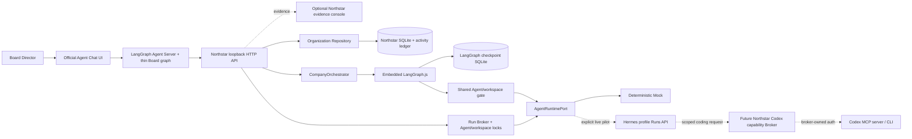
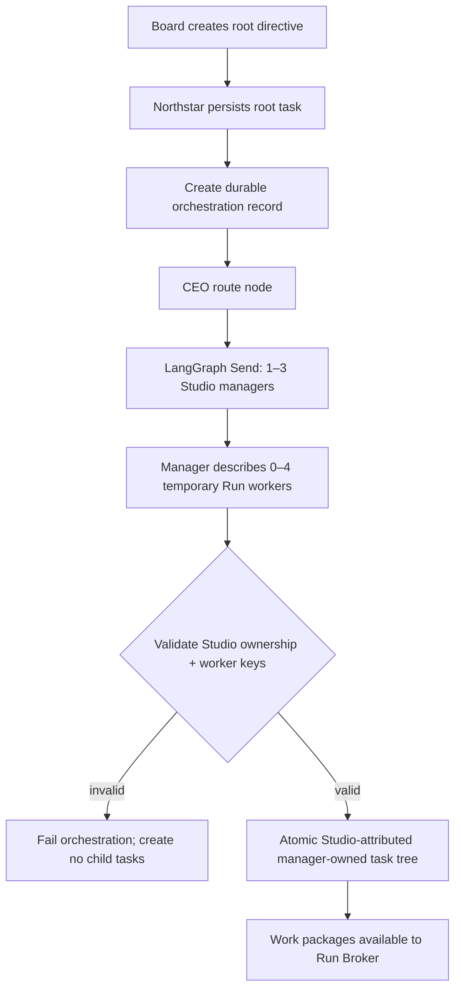

# Architecture

> **Personal VMware branch note:** the fixed 16-identity roster is preserved as
> compatibility data, but it is no longer the active planning model. The target
> and phase order are defined in
> [Personal VMware Foundation](personal-vmware-foundation-plan.md), and verified
> progress is tracked in
> [Personal VMware implementation status](personal-vmware-implementation-status.md).

The Personal VMware branch now has the first Phase 0 foundation: durable Studio
and replaceable instance contracts, an application Studio service, additive
SQLite persistence, idempotent heartbeat receipts, strict local Controller
schemas, a Mock VM provider boundary, and a read-only health view. This is not a
live VMware or authenticated guest integration. The implementation-status
ledger remains authoritative for phase completion.

The Phase 1 code path now includes an opt-in VMware Fusion adapter, but no live
VMware smoke has been performed. The adapter is not proof of a working local
VM integration until the manual disposable-VM gate is recorded.

### Personal Studio compatibility bootstrap

The current SQLite roster is preserved while the target Studio model is
introduced additively. Startup idempotently creates these stable mappings:

| Studio | Bootstrap manager identity | Reason |
| --- | --- | --- |
| GitHub Research & Experience | `agent-kai` | Existing technical manager identity |
| Content & Marketing | `agent-mira` | Existing editorial/social manager identity |
| OpenMontage Video Production | `agent-rowan` | Third existing manager identity reserved for the production boundary |

This mapping adds no permanent workers and does not claim that the legacy role
text or runtime profiles are final. Phase 4 must give each manager a versioned
Studio charter and scoped Hermes profile before live work. A stable-key conflict
fails startup instead of silently attaching a Studio to another identity.

The active company planner now routes through the Studio registry. A manager
may describe zero through four temporary workflows, subagents, or sandboxes,
but these descriptions never become Agent identities. Historical Team,
specialist, task, and plan records remain readable.

## Product model

The Board interacts with one company chat, not 16 chat boxes. Agents are durable organizational identities; tasks, Runs, decisions, and evidence are the coordination medium. Model sessions and chat threads are temporary compute/context.



The three live layers have deliberately different jobs:

| Layer | Owns | Must not own |
| --- | --- | --- |
| Northstar | Company identity, reporting lines, tasks, Runs, locks, approvals, audit and evidence | Model reasoning or a chat-centric identity model |
| LangGraph.js | The resumable route for one company directive | Permanent employees, long-term memory or final business truth |
| Hermes Agent | A profile's reasoning loop, model, skills, tools and later memory | Organizational authority, task ownership or Codex credentials |

## Why a modular monolith

Northstar remains one local TypeScript repository with a React app, Node API, shared domain package, and SQLite. LangGraph is embedded as a library. The difficult problem is ownership, permissions, evidence, and recovery—not distributed messaging. Hermes remains behind a small HTTP adapter so it can later run on the same Mac, in containers, or on Ubuntu without changing the domain model.

| Layer | Responsibility |
| --- | --- |
| `packages/core` | Domain contracts and workflow invariants |
| `apps/server/api` | Local HTTP boundary and runtime input/origin checks |
| `apps/server/application` | Company graph, Run queueing, concurrency and locking |
| `apps/server/infrastructure` | Northstar persistence, LangGraph checkpointer, Hermes/Codex adapters |
| Official Agent Chat UI | Primary Board conversation surface; no organizational authority |
| `apps/web` | Optional evidence and administration views |

## Core invariants

1. The Board owns intent and irreversible authority.
2. Every task has one accountable owner and may have one independent reviewer.
3. Hierarchy governs responsibility and routing without forcing every task through every layer.
4. An Agent identity belongs to Northstar. LangGraph `thread_id`, Hermes `run_id`, and Codex `threadId` never become the Agent.
5. A task and an Agent each have at most one active Run; a writable workspace has one writer.
6. Green work without a reviewer may finish; yellow/reviewer work stops at review; red work stops at Board approval.
7. Approval records authority. A separate scoped capability gateway must execute any external action.
8. All Codex work goes through the Northstar Broker; Hermes never receives Codex auth or a raw unrestricted Codex tool.

## Current company-planning flow



The graph currently covers routing and planning. A company-wide Mock directive
produces three manager mission tasks and three temporary-work-package tasks.
The compatibility roster gains no Agent identities. A Studio-targeted directive
uses one manager, while a manager is also allowed to retain work without
inventing a temporary worker. Repeating the same orchestration is idempotent at
the Northstar record/task-tree boundary. An in-flight graph checkpoint from the
legacy Team planner fails closed rather than being resumed under the new graph
schema.

The primary chat entry adds one transport layer before this flow:

```text
Agent Chat UI -> Board messages graph -> POST /api/board/turns -> durable root task -> CompanyOrchestrator
```

The Board graph never opens organization SQLite or constructs a second CompanyOrchestrator. It calls the loopback Northstar API, which remains the single durable writer. Northstar stores a request hash and a unique `(thread_id, message_id)` mapping so a retry cannot duplicate a directive or silently reuse the same message identity with changed content. The deterministic Avery reply is reconstructed from the durable company plan; it is not a second business source of truth.

The next graph stages are worker fan-out, evidence collection, manager synthesis, reviewer Runs, policy gates, and resumable Board interrupts. They are intentionally not represented as completed capabilities yet.

## Persistence boundaries

Northstar uses `.data/organization.sqlite` as the business source of truth. The embedded company graph uses a separate `.data/langgraph-checkpoints.sqlite` file and sets:

```text
thread_id = orchestration.langGraphThreadId
```

The local Agent Server separately owns temporary Board conversation checkpoints. Neither chat `thread_id` nor a chat message becomes an Agent identity. Checkpoints may contain routing state and IDs, but not OAuth tokens, raw secrets, large artifacts, or the only copy of a business decision. Hermes Run state is held by its Gateway and can disappear on restart; Northstar persists the corresponding durable Run and evidence. These persistence domains are intentionally not merged.

## Runtime and Run Broker boundary

Both graph planning and manager-owned work-package execution pass through one
shared Agent/workspace gate and then the same `AgentRuntimePort`. The gate
prevents two concurrent executions for one manager and serializes writable work
aimed at the same workspace. The current runtime implementations are:

- `MockAgentRuntime`: deterministic JSON routing/planning and safe execution summaries; no external calls.
- `HermesAgentRuntime`: guarded adapter over `POST/GET/stop /v1/runs`; live only when explicitly configured.

Studio work-package tasks enter the `RunBroker`, which enforces global
concurrency, one active Run per accountable manager, and one writable Run per
workspace. Their temporary-worker fields currently describe future execution;
Phase 5 will create the actual disposable sandbox/subagent. LangGraph nodes do
not bypass this broker. Hermes approval waits trigger a stop request and an
error; they are never converted into an automatic approval.

For the pinned Hermes commit, the first live deployment uses one dedicated loopback Gateway/port/key per profile and the normal `/v1/runs` path. Profile-prefixed multiplex Runs routes remain opt-in and unverified.

## VMware Fusion lifecycle boundary

The Controller lifecycle path is:

```text
loopback API action
-> VmLifecycleService
-> durable pending operation + activity
-> VmwareFusionProvider
-> direct vmrun executable + fixed argument vector
-> durable success/failure + activity, or retained pending indeterminate state
```

- The API accepts Studio ID, instance ID, idempotency key, and an allowlisted
  action. It never accepts a VM path.
- SQLite resolves the current non-revoked Studio instance and its configured
  provider path.
- Startup enables the adapter only when the configured Studio, instance, and
  `.vmx` path match that durable tuple.
- A complete configured target is read-only by default. Observation remains
  available, but the application rejects start, stop, suspend, and resume
  before an operation or provider call unless the separate
  `VMWARE_FUSION_ACTIONS_ARMED` value is exactly `true` and
  `VMWARE_FUSION_ACTIONS_ARMED_UNTIL` names a future deadline no more than 30
  minutes after startup. The application rechecks the deadline before every
  action and fails closed before persistence or provider execution after it
  expires.
- Before the HTTP server listens, an infrastructure-only preflight checks that
  the exact configured `vmrun` path is an executable regular file and the exact
  configured VMX path is a readable regular file. Their final path components
  must not be symbolic links. The preflight does not invoke the runner,
  enumerate a directory or VM, or return either host path.
- The provider repeats that no-command file check immediately before every new
  lifecycle action and rechecks the VMX final path for read-only observation.
  If either configured file was removed, made inaccessible, or replaced by a
  symbolic link after startup, the request stops before the process runner.
  This narrows the local replacement window; it does not claim to defend
  against a privileged host process racing the final check and `execFile`.
- The provider rejects every target except its one configured
  `(studioInstanceId, vmxPath)` pair.
- `vmrun` is launched without a shell. Paths containing spaces remain one
  argument. Each command has a 30-second wall-clock timeout and 64 KiB output
  bound.
- Observation checks only the configured VM's `.vmx.lck`, VMX
  `checkpoint.vmState`, and in-bundle `.vmss`; it does not enumerate other VMs.
  A Node filesystem lookup interprets only `ENOENT` as a missing lock or state
  file. Permission errors, symlink loops, any direct lock/checkpoint symbolic
  link, malformed path traversal, and other access faults propagate through the
  sanitized provider boundary rather than being silently converted into
  `false` and an incorrect lifecycle state.
- A request is written as pending before execution. Successful and failed
  results are durable, and the same idempotency key cannot trigger a blind
  retry after restart. A partial unique SQLite index permits at most one pending
  lifecycle operation per Studio instance, so a different key or action cannot
  run concurrently or bypass an indeterminate operation. The atomic repository
  check maps this condition to `VM_OPERATION_IN_PROGRESS` before a provider
  call. If a legacy database somehow contains multiple pending operations for
  one instance, startup fails closed without deleting either record.
- Pending lifecycle ownership also fences durable Studio identity. Inside the
  same `BEGIN IMMEDIATE` transaction, instance creation/replacement and Studio
  retirement reject with `STUDIO_VM_OPERATION_IN_PROGRESS` if any lifecycle
  operation for that Studio is still pending. Conversely, a new lifecycle
  insertion revalidates the non-revoked instance and non-retired Studio after
  acquiring its write transaction. Whichever mutation wins the SQLite lock is
  authoritative; the other fails before identity, activity, or provider state
  can be partially changed. Succeeded and failed history does not hold this
  fence.
- The application validates provider observations and receipts at runtime
  before they become durable evidence. Unknown statuses, invalid timestamps,
  empty receipt IDs, and action/state combinations outside the lifecycle
  contract fail closed and cannot be replayed as a new provider call.
- Raw provider errors are not trusted evidence. The Fusion adapter replaces its
  configured executable and VMX paths, their non-root parent directories, and
  in-bundle state-file paths with stable labels; the application persists
  diagnostics only from the explicit sanitized provider error type and
  substitutes a generic diagnostic for unknown errors. HTTP clients receive
  stable failure messages rather than provider output or host paths. Root
  directories are never used as replacement tokens because replacing `/`
  would destroy the diagnostic rather than redact a scoped configured path.
- `GET /api/studios/:studioId/instances/:instanceId/vm/evidence` reads the
  durable ledger independently of whether the live provider is enabled. It
  supports current or revoked instances, enforces Studio ownership, returns at
  most 100 newest operations/events with truncation flags, and omits provider
  targets, receipt IDs, raw diagnostics, and activity detail.
- `GET /api/studios/:studioId/instances/:instanceId/vm/access` reports a
  path-free runtime snapshot: configured/preflight state, action mode
  (`disabled`, `read_only`, `armed`, or `expired`), whether actions are
  currently allowed, the deadline, and durable-target eligibility
  (`not_configured`, `eligible`, `instance_revoked`, or `studio_retired`). It
  re-reads Studio and instance state for every request. An exact process-level
  configuration therefore becomes `disabled` immediately after replacement or
  retirement rather than continuing to display `armed`; a different current
  generation remains `not_configured` until Northstar is safely reconfigured.
  The endpoint enforces Studio-instance ownership and remains available when
  the provider is disabled. This snapshot is operational evidence only; it is
  not a durable Board approval and cannot execute an action.
- `GET /api/studios/:studioId/instances/:instanceId/vm/smoke-check` takes one
  safe `sessionPrefix` and reads only the redacted evidence service. For keys
  `<prefix>-start`, `-suspend`, `-resume`, and `-stop`, it checks uniqueness,
  durable success/receipt facts, the exact
  `stopped -> running -> suspended -> running -> stopped` chain, timestamp
  order, non-truncated evidence, and minimum lifecycle activity counts. It has
  no provider dependency and cannot execute `vmrun`.
- A successful automated smoke check is deliberately incomplete proof. The
  response always lists manual requirements for Board approval, access-state
  snapshots, the replay response, event-to-session correlation, confirmation
  that another VM was untouched, installed versions, final observation,
  disarming, and cleanup. These requirements prevent a redacted aggregate
  ledger from being mistaken for the Phase 1 manual gate.
- If the provider returns a receipt or throws but the corresponding final
  SQLite update fails, the operation remains pending. The application returns
  the stable
  `VM_OPERATION_INDETERMINATE` conflict without exposing the persistence
  failure, never rewrites the operation as failed, and rejects the same key as
  already pending on replay. Phase 3 reconciliation must resolve that
  ambiguous state rather than guessing.
- A process-runner rejection or forced `vmrun` termination is also externally
  ambiguous. The process runner distinguishes timeout, output-limit
  termination, and an independent operating-system signal from an ordinary
  nonzero exit. If the runner Promise rejects instead of returning any result,
  the adapter likewise cannot prove whether the process spawned. The Fusion
  adapter marks all of these cases as explicit indeterminate provider outcomes.
  The application leaves the existing pending request untouched, emits no false
  failure event, returns the same stable conflict, and prevents the same
  idempotency key from reaching the provider again. An operator must inspect the
  disposable VM state before any new lifecycle action.
- A zero `vmrun` exit is not sufficient success evidence. After the command,
  every observation/read/delay/receipt-clock failure and an observed state that
  does not converge within the bounded attempts are classified as
  indeterminate. The adapter cannot truthfully convert these post-command
  verification failures into a failed external action; Northstar retains the
  pending request and follows the same reconcile-before-retry rule.

The adapter and its write actions are independently disabled by default, and
every automated test uses fakes. The
[manual lifecycle runbook](runbooks/vmware-fusion-lifecycle-smoke.md) is the
remaining Phase 1 exit gate.

## Codex boundary

Codex is a future scoped engineering capability, not the default employee runtime. The repository retains a defensive Codex CLI adapter as reference, but this milestone does not wire Hermes to it.

The allowed future path is `Hermes -> Northstar capability -> Codex Broker -> codex mcp-server or codex exec --json`. The Broker owns the OS login, workspace policy, queue, and exact thread mapping. A ChatGPT OAuth login is shared identity/usage, not 16 credentials, and should initially have one serialized runner stream.

## Known limitations

- Hermes profiles, model-provider credentials, and a real Gateway have not been provisioned or live-tested.
- Worker execution is started per task; automatic graph fan-out and manager evidence synthesis are not implemented.
- Queue leases and live Run reconciliation are not persisted across a server restart.
- Organization configuration is seeded in code rather than editable in the UI.
- Agent memory, artifacts, role versioning, secret vaulting, cancellation, streaming, and backups are not implemented.
- Approval has no connector capability behind it, so it cannot publish or mutate external systems.
- The official chat UI is currently an ignored pinned upstream checkout rather than a vendored package; the service is single-user/loopback-only.

## Roadmap

1. Verify one dedicated Hermes profile against the pinned `/v1/runs` contract, then pilot `CEO -> one manager`.
2. Add persistent queue leases, restart reconciliation, cancellation, artifacts, and idempotent external-call receipts.
3. Extend the graph through worker Runs, manager review, CEO synthesis, policy gates, and Board interrupts.
4. Add versioned charters and scoped memory while keeping Northstar as the durable organizational truth.
5. Implement the scoped Codex capability Broker, then safe external capability gateways with one-time authorization.
6. Add wake events, schedules, health supervision, daily briefs, backups, and an Ubuntu deployment. Resident means durable state plus event-driven waking—not continuous token burn.
