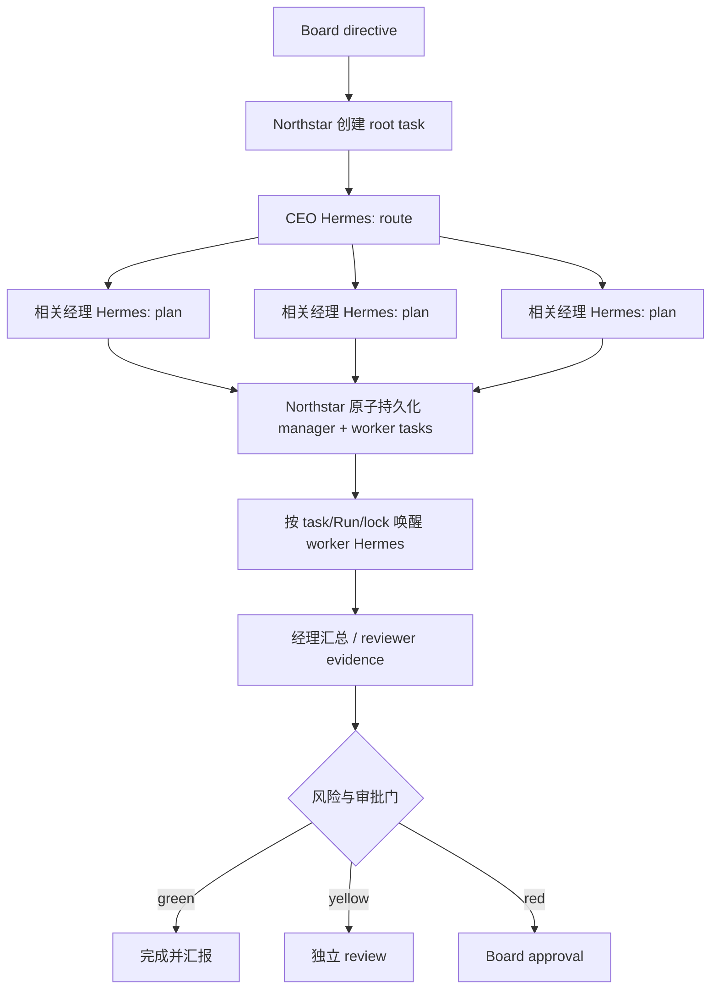

# Hermes + LangGraph 集成与 Linux 部署设计

> 状态：DeepSeek 单 profile pilot 已接入，2026-07-14。本文区分“通过显式 live smoke 的能力”和“尚未完成常驻验证的能力”。单次模型连通不等于 16-profile、Codex Broker 或无人值守运行已经完成。

## 结论

Northstar 不再重做一个 Agent runtime，也不把 LangGraph 当作公司数据库。三个层次保持清楚：

| 层次 | 唯一职责 | 不负责什么 |
| --- | --- | --- |
| Northstar | 永久组织身份、任务所有权、Run、锁、审批、证据和审计 | 不充当模型，不把聊天线程当员工 |
| LangGraph.js | 一次公司任务的嵌入式执行路线：CEO 路由、经理拆解、并行汇合、中断和恢复 | 不保存员工人格，不成为最终任务真相 |
| Hermes Agent | 每个数字员工的 profile runtime：角色提示、记忆、技能、模型和工具执行 | 不拥有公司权限，不直接掌握 Codex 登录 |

Codex 是工程岗位可请求的执行工具，不是第四层组织，也不是某个永久 Agent 的身份。唯一允许的调用链是：

```text
Hermes profile
  -> Northstar scoped capability
  -> Northstar Codex Broker
  -> broker-owned codex mcp-server 或 codex exec --json
  -> 独立 Codex thread/worktree
  -> 结果与证据回到 Northstar
```

禁止 `Hermes -> codex mcp-server` 直连。即使 Hermes 能消费 MCP，也必须先经过 Northstar Broker，否则会绕过 Agent/任务锁、workspace 单写者、风险审批和用量记录。

## 上游基线与固定版本

`.upstream/` 是只读研究快照并已被 Git 忽略。Northstar 不复制或修改大段上游源码；正式运行通过固定依赖或固定 commit 安装，适配代码只依赖小而明确的协议面。

| 上游 | 用途 | 当前固定 commit |
| --- | --- | --- |
| [NousResearch/hermes-agent](https://github.com/NousResearch/hermes-agent) | 员工 runtime、profile、Gateway、Runs API | [`b03c94dbed5ee72e97eace2376e02092cc854f6a`](https://github.com/NousResearch/hermes-agent/commit/b03c94dbed5ee72e97eace2376e02092cc854f6a) |
| [langchain-ai/langgraphjs](https://github.com/langchain-ai/langgraphjs) | Northstar TypeScript 编排参考与运行库 | [`ada0b67696d2dadb59c2f274f45c585aa4fef0e4`](https://github.com/langchain-ai/langgraphjs/commit/ada0b67696d2dadb59c2f274f45c585aa4fef0e4) |
| [langchain-ai/langgraph](https://github.com/langchain-ai/langgraph) | Python 实现与架构对照，不是 Northstar runtime 依赖 | [`55ec2f21939ce7755e6398c11b541de8926245ee`](https://github.com/langchain-ai/langgraph/commit/55ec2f21939ce7755e6398c11b541de8926245ee) |
| [langchain-ai/agent-chat-ui](https://github.com/langchain-ai/agent-chat-ui) | 董事会的官方单聊天界面，本地直连 Board graph | [`1cbd509d387b1e9602a80f05e638058b7543d7cc`](https://github.com/langchain-ai/agent-chat-ui/commit/1cbd509d387b1e9602a80f05e638058b7543d7cc) |

仓库的 `package-lock.json` 当前锁定 `@langchain/langgraph` 1.4.7 和 `@langchain/langgraph-checkpoint-sqlite` 1.0.3。Linux 部署使用 `npm ci`，不要只凭 `package.json` 的范围重新解析版本。升级任何上游前先跑协议测试，再单独更新这里的 commit/包版本记录。

## 目标组织：16 个长期身份

董事会是人，不计入 16 个 Agent。组织是 1 个 CEO/Chief of Staff、3 个经理、每位经理 4 个直属 specialist：

```text
Board（人）
└── Avery / CEO                         profile: ceo
    ├── Mira / Social Manager           profile: social-manager
    │   ├── Iris / Audience Researcher  profile: audience-researcher
    │   ├── Theo / Content Maker        profile: content-maker
    │   ├── Lyra / Channel Producer     profile: channel-producer
    │   └── Sage / Growth Analyst       profile: growth-analyst
    ├── Kai / Engineering Manager       profile: engineering-manager
    │   ├── Nova / Codex Engineer       profile: codex-engineer
    │   ├── Atlas / Systems Architect   profile: systems-architect
    │   ├── Tess / Test Engineer        profile: test-engineer
    │   └── Quinn / Quality Reviewer    profile: quality-reviewer
    └── Rowan / Life Manager            profile: life-manager
        ├── June / Planning Coordinator profile: planning-coordinator
        ├── Sol / Travel Researcher     profile: travel-researcher
        ├── Vale / Health & Habits      profile: health-habits
        └── Morgan / Knowledge Steward  profile: knowledge-steward
```

“长期身份”表示 profile、角色、记忆、技能和工作历史长期存在；不表示 16 个模型进程持续推理。正常任务只唤醒 CEO、相关经理和必要的 1–4 个 specialist。Northstar 仍强制：一个任务一个 accountable owner、一个 Agent 至多一个 active Run、一个 workspace 至多一个 writable Run。

这些标识不能相互替代：

| 标识 | 生命周期 | 所属系统 |
| --- | --- | --- |
| `agent.id` | 永久 | Northstar 组织数据库 |
| `runtimeProfile` | 长期，可版本化 | Hermes profile |
| LangGraph `thread_id` | 一次 orchestration，可恢复 | LangGraph checkpointer |
| Hermes `run_id` | 一次 Agent 执行 | Hermes Gateway |
| Hermes `session_id` / `X-Hermes-Session-Key` | 对话连续性 / 记忆作用域 | Hermes |
| Codex `threadId` | 一次 coding 会话，可续接 | Codex，由 Broker 保存映射 |

## LangGraph 嵌入式编排

LangGraph 作为 `apps/server/application` 内的库运行，不另起一个“LangGraph 公司服务”。建议的公司图为：



当前 graph 骨架的安全边界是 CEO 最多路由 3 个部门、经理最多选择 4 个直属员工，并验证不能跨部门借人。它目前只完成“CEO 路由 + 经理规划”这一段；worker 执行、经理回收证据、reviewer Run 和 Board interrupt 仍是后续步骤，不能在 UI 或部署说明中宣称已经完成。

编排状态的规则：

- Northstar SQLite 是任务、owner、approval 和 Run 的 source of truth。
- LangGraph checkpoint 只保存执行游标和图内临时状态；恢复时重新核对 Northstar 的任务状态和锁。
- LangGraph `thread_id` 使用 `orchestrationId`，绝不能使用 `agent.id`。
- worker 执行只从持久 child task 进入 Run Broker。CEO/经理的 route/plan 与 worker Run 共同经过一个 Agent/workspace gate，因此同一员工和同一 writable workspace 不会并发执行。当前 planner execution 仍只记录在 orchestration 而未单独持久化成 Run；在补齐 planner Run/restart reconcile 前，live 仍只属于 private pilot。
- 重试必须带 Northstar idempotency key；不得假设第三方 endpoint 自动去重。
- 高风险步骤使用显式 interrupt/状态转换，不依靠提示词中的“请先问我”。

## Hermes Runs API 契约

固定 Hermes commit 的 API Server 暴露以下控制面：

| 操作 | Endpoint | Northstar 用法 |
| --- | --- | --- |
| 启动 | `POST /v1/runs` | 返回 `202` 与 `run_id` |
| 查询 | `GET /v1/runs/{run_id}` | 首版采用轮询，读取 terminal status/output/usage |
| 事件 | `GET /v1/runs/{run_id}/events` | SSE；后续用于 delta、tool 和 approval 证据 |
| 审批 | `POST /v1/runs/{run_id}/approval` | 存在于上游，但 Northstar 不自动批准 |
| 停止 | `POST /v1/runs/{run_id}/stop` | cooperative stop；请求返回不代表执行线程已立即退出 |

请求使用 `Authorization: Bearer <API_SERVER_KEY>`。上游拒绝无 key 或弱于 16 字符的 key；推荐每个 profile 生成独立 32-byte 随机值。`API_SERVER_HOST` 必须保持 `127.0.0.1`，默认端口是 8642。上游实现在 [api_server.py](https://github.com/NousResearch/hermes-agent/blob/b03c94dbed5ee72e97eace2376e02092cc854f6a/gateway/platforms/api_server.py)。

独立 profile gateway 的请求形状应当是：

```http
POST http://127.0.0.1:8701/v1/runs
Authorization: Bearer <profile-specific-secret>
Content-Type: application/json
X-Hermes-Session-Key: northstar:company-northstar:agent:agent-avery

{
  "input": "任务和受控 context",
  "instructions": "该岗位本次 Run 的指令",
  "session_id": "northstar-run-<id>"
}
```

需要特别记录的上游行为：

- `run_id`、status 和 terminal output 保存在 Gateway 进程内存中；Gateway 重启后不能把它当 durable truth。Northstar 必须保存自己的 Run 并在重启时把未决 live Run 标记为待 reconcile。
- `/v1/runs` 当前不会因为 `Idempotency-Key` 自动去重；Northstar 可以发送该 header 作为未来兼容信息，但启动请求在“不知道是否已被服务端接受”的网络错误后不得盲目重试。
- `X-Hermes-Session-Key` 是长期记忆 scope，`session_id` 是执行/对话 scope；二者都不是 profile 路由或授权凭据。
- `waiting_for_approval` 不能被自动转换成 allow。安全的首版行为是请求 stop、记录 evidence，并把任务交还 Northstar 的审批/人工流程。
- API Server 的异步后台 delivery 被上游标记为不支持；首版不依赖“Run HTTP 响应结束以后还会主动推送结果”。
- 输入、输出和错误都要在 Northstar HTTP/adapter 边界做 runtime validation，不能只相信 TypeScript 类型。

## Profile multiplex 与独立端口

Hermes 有 opt-in 的 `gateway.multiplex_profiles`。上游意图是在一个 Gateway 内按 profile 切换 `HERMES_HOME`、skills、memory 和 secret scope，从而减少常驻进程与端口。这个方向适合未来，但不适合作为当前 Runs API 的首个 live 基线。

原因是固定 commit 中存在一个明确的契约缺口：

- `gateway/run.py` 的 multiplex 注释描述 `/p/<profile>/` 路由，并且禁止 secondary profile 自己绑定 `api_server` 端口。
- 但同一 commit 的 `gateway/platforms/api_server.py` 只注册 `/v1/runs*`，没有注册 `/p/{profile}/v1/runs*`，也没有读取 profile header/path。
- 因此 `/p/<profile>/v1/runs` 只能视为尚未验证的可选路由，不能作为 live 基线。

两种方案的取舍：

| 方案 | 优点 | 当前风险 | 决定 |
| --- | --- | --- | --- |
| 一个 multiplex Gateway | 一个进程/端口，资源较轻，profile secret scope 由上游切换 | 固定 commit 没有已确认的 profile-aware Runs route | 暂不启用 |
| 每 profile 一个 Gateway + 独立端口 | profile/secret/进程边界清楚，直接使用已存在的 `/v1/runs` | 最多 16 个轻量 Gateway 进程和 16 个 loopback 端口 | 首个 live pilot 的基线 |

建议端口规划：

| Profile | Port | Profile | Port |
| --- | ---: | --- | ---: |
| `ceo` | 8701 | `social-manager` | 8710 |
| `audience-researcher` | 8711 | `content-maker` | 8712 |
| `channel-producer` | 8713 | `growth-analyst` | 8714 |
| `engineering-manager` | 8720 | `codex-engineer` | 8721 |
| `systems-architect` | 8722 | `test-engineer` | 8723 |
| `quality-reviewer` | 8724 | `life-manager` | 8730 |
| `planning-coordinator` | 8731 | `travel-researcher` | 8732 |
| `health-habits` | 8733 | `knowledge-steward` | 8734 |

每个 profile 的 `.env` 至少需要不同的：

```dotenv
API_SERVER_HOST=127.0.0.1
API_SERVER_PORT=<assigned-port>
API_SERVER_KEY=<unique-strong-secret>
```

设置 `API_SERVER_KEY` 会启用 upstream API Server。Northstar 配置已支持 `runtimeProfile -> { baseUrl, apiKey }` 的 dedicated endpoint 映射；独立端口模式请求未加 prefix 的 `/v1/runs`，并有无网络 contract test。当前 key 仍从本机 `.env` 进入进程，下一步才是改为 secret reference；它不会写入 organization SQLite 或 activity。真实单 profile contract smoke test 仍是启用 live 前的硬门槛。

如果以后采用 multiplex，启用条件是：上游出现并固定一个明确的 profile-aware Runs API；或者我们增加一个很薄、经过契约测试的 profile router。不能用 `session_id` 或 `X-Hermes-Session-Key` 冒充 profile 路由。

## Codex OAuth 与 Broker

“Codex OAuth”是 `codex login` 打开的 ChatGPT OAuth 登录流程。它让 Codex CLI 使用该 ChatGPT 订阅/工作区权限；它不是 16 个 Hermes Agent 各自拥有的凭据。[OpenAI Authentication](https://learn.chatgpt.com/docs/auth)

官方行为与约束：

- `codex exec` 默认复用本机已保存的 CLI 登录。
- 登录保存在 OS keyring，或 `$CODEX_HOME/auth.json`；`auth.json` 含 access/refresh token，必须按密码管理。
- 共用一个登录只共用身份、权限和用量池；新 Codex thread 仍有独立上下文。
- OpenAI 的可信 runner 指南要求一个 `auth.json` 只服务一个 runner 或一个串行 workflow stream，不应跨并发 jobs/多台机器共享。[Maintain Codex account auth in CI/CD](https://learn.chatgpt.com/docs/auth/ci-cd-auth)
- 官方仍建议一般自动化使用 API key；ChatGPT-managed auth 只用于确实需要账户权限的可信私有自动化。[Non-interactive mode](https://learn.chatgpt.com/docs/non-interactive-mode)

因此 Northstar 的安全设计是：

1. 只有 Codex Broker 的 OS 用户可以读取 Codex credential store。
2. Hermes profile 的 `.env` 中不得出现 `CODEX_ACCESS_TOKEN`、OpenAI API key 或 `auth.json` 副本。
3. ChatGPT OAuth 模式先使用一个串行 Codex 执行槽；16 个 Agent 可以排队，但不能把一份 `auth.json` 复制成 16 份并发刷新。
4. Broker 为每个 coding Run 创建独立 workspace/worktree 和 Codex thread，保存精确 `threadId`；并发环境绝不使用 `resume --last`。
5. Broker 固定 sandbox，忽略 Hermes 提交的 `danger-full-access`、`--yolo` 或 approval-policy 放宽请求。

内部 Codex adapter 有两种可替换实现：

- `codex exec --json`：当前较小、稳定的进程边界，JSONL 中的 `thread.started`、工具事件和 usage 可进入 Northstar evidence。
- `codex mcp-server`：OpenAI 标为 Stable，专门让另一个 Agent/client 调用 Codex；只允许 Broker 通过 stdio 持有它。它暴露 `codex` 与 `codex-reply(threadId)`。[Running Codex as an MCP server](https://learn.chatgpt.com/docs/mcp-server)

不把 raw `codex app-server` protocol 作为核心契约；OpenAI 当前将它标为 Experimental。若未来使用远程 App Server，Codex access token 与 client-to-server transport token 必须分离，非本机连接必须使用 TLS 和独立 transport authentication。[Codex App Server](https://learn.chatgpt.com/docs/app-server#connect-the-cli-terminal-ui)

## Mock-first 状态

当前默认仍是 Mock：

- `HERMES_EXECUTION_MODE=mock` 不启动 Hermes、不消耗模型/Codex 用量，也不修改 workspace。
- LangGraph 的结构测试使用 controlled/mock `AgentRuntimePort`，不启动 Hermes、模型 API 或 Codex。
- dedicated Runs 路由已经通过 macOS 上的真实 Hermes + DeepSeek smoke，并完成一次 `CEO -> Product Lead` 规划；multiplex、SSE 重连、16-profile 常驻和 Linux service 仍未 live 验证。
- 没有配置模型 API 时，16 个 Hermes profile 只能作为待部署身份；不得通过偷偷复用 Codex OAuth 把 Hermes 主模型“补上”。
- 自动测试禁止切换 live Codex。真实 smoke test 必须由人显式启动、使用隔离 workspace，并记录执行时间、commit 和证据。

## DeepSeek pilot 启动器

仓库的 `scripts/hermes-live.mjs` 只缝合已有边界，不重写 Hermes：

- `npm run hermes:smoke` 启动 `ceo` 的独立 Hermes Gateway，并通过 Northstar 自己的 `HermesRunsClient` 执行一次 `POST /v1/runs -> GET /v1/runs/{id}` contract smoke。
- `npm run dev:live` 启动当前规划图需要的四个 profile：`ceo`、`social-manager`、`engineering-manager`、`life-manager`，再把一次性本地 Gateway key 注入 Northstar。
- macOS 从 Keychain 读取 DeepSeek key；Linux 从服务环境的 `DEEPSEEK_API_KEY` 读取。provider key 不进入 Northstar、浏览器、SQLite 或命令参数。
- profile 的可变状态位于 `.data/hermes/<profile>`；首次启动从 `config/hermes` 复制配置和 `SOUL.md`，之后不覆盖其持久记忆或身份文件。
- pilot 使用 `deepseek-v4-flash` 且关闭 thinking，降低验证成本并避免工具回合的 reasoning replay 问题。四个 profile 仅有内存 `todo` 工具，没有 terminal、file、browser 或 external connector。

这是当前规划阶段的最小 live 集合，不是最终 16-profile 常驻部署。worker gateway 只在专员任务真正 dispatch 时才需要。

## Ubuntu/Linux 部署形态

首个 Linux 目标是单机、单用户、loopback-only；不是公网 multi-tenant 服务。

```text
Ubuntu host
├── northstar server       127.0.0.1:4318
│   ├── SQLite / activity ledger
│   ├── embedded LangGraph
│   └── Codex Broker -> stdio codex mcp-server / child codex exec
├── Hermes ceo             127.0.0.1:8701
├── Hermes social profiles 127.0.0.1:8710-8714
├── Hermes eng profiles    127.0.0.1:8720-8724
└── Hermes life profiles   127.0.0.1:8730-8734
```

### 主机与用户边界

- 使用专用非 root 用户运行 Northstar、Hermes 和 Codex Broker；不要让 Web 用户直接执行 Gateway。
- Northstar 需要 Node.js 22.13+；Hermes 上游安装器使用 Python 3.11/`uv`。Codex CLI 也在同一专用用户下安装。
- Northstar 数据、Hermes profile home 和 Codex credential store 分目录保存，目录权限 `0700`，secret/auth 文件 `0600`。
- 只把 Board UI 暴露给受信任入口；Northstar loopback API、Hermes ports 和 Codex stdio 不经反向代理公开。
- 如果 Hermes terminal backend 使用 host-local shell，API key 泄漏等同于该 OS 用户的代码执行能力。需要跨主机开放时，先放进容器/VM 与防火墙，再考虑 TLS。

### Profile 与服务

上游支持 `hermes -p <profile> gateway ...`，在 Linux 上会生成 profile-scoped 的 `hermes-gateway-<profile>.service`。下面只是部署 runbook 草案，尚未在本仓库的 Ubuntu 主机执行：

1. 按固定 Hermes commit 安装，不追踪 `main`。
2. 创建 16 个 named profile，并为每个 profile 写入角色 charter、独立 `.env`、端口和 API key。
3. 保持 `gateway.multiplex_profiles: false`。
4. 为首批 pilot profile 执行 `hermes -p <profile> gateway install --start-now --start-on-login`；通过后再扩展到 16 个。
5. 使用 `GET /health` 检查进程，使用带 Bearer auth 的 `GET /health/detailed` 检查模型/readiness；仅进程存活不等于可执行 Run。
6. 如果启用 Hermes Kanban，多 Gateway 只能有一个 `kanban.dispatch_in_gateway: true`，其余为 `false`，避免多个 dispatcher 争用同一 SQLite/WAL。[Multi-gateway deployment](https://github.com/NousResearch/hermes-agent/blob/b03c94dbed5ee72e97eace2376e02092cc854f6a/docs/kanban/multi-gateway.md)

### Ubuntu 上的 Codex 登录

在运行 Broker 的同一个专用用户下执行：

```bash
codex login --device-auth
codex login status
```

无桌面 Linux 可以使用 device flow。若采用 file credential store，`$CODEX_HOME/auth.json` 只能由该用户读取，并由一个串行 Broker stream 维护；不要将 Mac 上的 auth 文件随项目复制或提交。官方允许在可信私有 runner 中安全 seed/persist `auth.json`，但 API key 仍是一般自动化默认，是否继续使用 ChatGPT-managed auth 应在 live pilot 后单独决策。

### 启动与恢复顺序

1. 启动需要的 Hermes profile Gateway，等 `/health/detailed` ready。
2. 启动 Northstar，仍保持 Mock；读取 organization 和 profile registry。
3. 运行单 profile、只读、无 Codex 的 Hermes contract smoke test。
4. 显式启用 Hermes live pilot，先只跑 `CEO -> 一个经理`。
5. 单独验证 `Hermes -> Northstar Broker -> Codex` 的一个隔离工程任务。
6. 才允许更多 profile；对同 workspace 的 writable Run 始终串行。

当前 Northstar queue 仍是内存队列，Hermes run status 也在 Gateway 内存中。持久化 lease、重启 reconcile、取消和 graceful shutdown 未完成前，这一部署只能称为 private pilot，不能称为无人值守 production。

## 安全检查表

- [ ] `HERMES_EXECUTION_MODE` 默认仍为 `mock`。
- [ ] 上游 commit 与 `package-lock.json` 在部署记录中固定。
- [ ] 每个 Hermes API Server 只绑定 `127.0.0.1`，使用独立强 key。
- [ ] Northstar 保存 `apiKeySecretRef`，不把明文 secret 写入 SQLite/activity。
- [ ] profile 路由使用独立 endpoint；没有把 session key 当 profile。
- [ ] `/v1/runs` 的未知启动结果不自动重试，避免重复 Run。
- [ ] Hermes approval request 不自动 allow；停止并转入 Northstar evidence/审批。
- [ ] 所有 Codex 请求只通过 Broker，Hermes 无 Codex credential。
- [ ] ChatGPT OAuth 下 Codex jobs 串行，精确保存每个 `threadId`。
- [ ] writable workspace 单写者，默认 sandbox 为 `read-only`。
- [ ] 发布、消息、日历、付款和 destructive connector 没有绕过 capability gateway。
- [ ] live smoke test 不进入自动测试，并使用隔离 workspace。

## Live 前必须通过的验收门

1. 用固定 Hermes commit 启动一个独立 profile Gateway，验证未加 profile prefix 的 `/v1/runs` start/poll/stop 契约。
2. 为真实 Gateway 补充 timeout、unknown-start-result 和重启后的 reconcile 测试；网络结果不确定时不得盲目重试 POST。
3. 证明一次 orchestration 重启后能从 Northstar durable state 恢复，而不是相信 Hermes/LangGraph 内存。
4. 证明两个 Agent 不会共享 Hermes memory scope；两个 Codex jobs 不会共享 `threadId` 或 writable worktree。
5. 证明任何 red/external action 最终停在 Board/capability gate，approval record 本身不会执行副作用。
6. 在 Ubuntu pilot 中记录 CPU/RAM/启动时间，再决定 16 个独立 Gateway 是否长期常驻，或等待上游补齐可验证的 Runs multiplex。

当前正确描述是：**LangGraph 公司编排与 DeepSeek-backed 的 CEO + 3 经理规划链路已通过本机 live smoke；16-profile 执行、Runs multiplex、Codex MCP 联通、重启 reconcile 和 Ubuntu 常驻部署尚未完成验证。**
