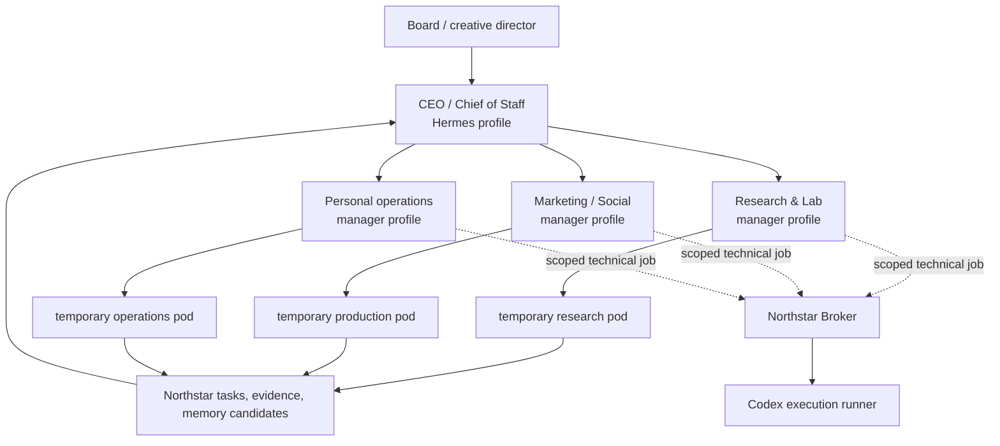

# Northstar Studio Blueprint

## Purpose

Northstar House is the private, local-first control plane for a personal AI
studio. It is not a chatroom full of interchangeable bots, and it is not a
fully autonomous company. The Board remains the human decision-maker. The
system gives the Board a durable organization that can wake for work, preserve
evidence, coordinate specialist execution, and stop safely at authority
boundaries.

This document captures the operating model agreed during exploration. It is a
product blueprint, not a claim that every described capability is implemented.
For the implemented system boundaries, see [architecture.md](architecture.md).

## The core idea



The organization is deliberately hierarchical for accountability, but it is
not a permanent 16-person debate. A manager owns the result, delegates only
when parallel exploration or independent review is valuable, and synthesizes
evidence for the next manager or the Board.

## Responsibilities

| Component | Owns | Does not own |
| --- | --- | --- |
| Board | Intent, priorities, irreversible decisions, final taste | Routine execution or every intermediate discussion |
| Northstar | Agent identities, reporting lines, tasks, Runs, approval records, evidence ledger and policy | A model's private chain of thought or a provider credential |
| Hermes profile | A durable employee's reasoning loop, role prompt, skills, tools and working memory | Organizational authority, unrestricted credentials or direct payment/publishing power |
| Manager | A department outcome, task decomposition, review and synthesis | A requirement to use every subordinate on every task |
| Specialist pod | A bounded investigation, production or verification job | Long-term organizational truth or unrestricted host access |
| Codex runner | High-quality code changes, repo analysis, test/verification and structured artifacts | An employee identity, the organization memory store or unbounded external authority |

## Hermes and Codex relationship

Hermes is the persistent employee runtime. Codex is an on-demand technical
executor. A Hermes manager may ask for a coding or verification capability, but
it must never inherit the user's Codex OAuth session or `auth.json`.

```text
Hermes manager
  -> Northstar task and scoped capability request
  -> Broker selects workspace, sandbox, budget and Codex concurrency slot
  -> codex exec / future Codex MCP runner
  -> logs, diff, tests and artifact references
  -> manager review and durable evidence
```

This keeps a single account's usage and credentials in a trusted Broker while
allowing different role prompts to commission different kinds of Codex work.
Any candidate memory produced by a model is reviewed before it becomes durable
organization memory.

## Operating rhythm

1. The Board gives a directive or approves a recurring objective.
2. The CEO decides whether it belongs to one department or needs a short,
   evidence-based cross-functional brief.
3. A department manager creates a small task tree with one accountable owner
   per task.
4. Specialists work independently where useful; otherwise the manager works
   directly. They write evidence, not a stream of internal chat.
5. A manager reviews the result and escalates only decisions, trade-offs and
   material uncertainty.
6. The CEO composes a Board brief. Green work may finish; yellow/review work
   waits for review; red work waits for the Board.

“Meetings” are therefore exceptions: a manager requests a bounded synthesis or
disagreement review only when independent work has produced a decision that
cannot be resolved from the evidence. They are not continuous multi-agent
conversation.

## Initial studio: GitHub Signal Studio

The first real department is a social-media research and production studio. On
a two-day cycle it should:

1. discover notable, newly active GitHub projects;
2. score novelty, audience curiosity, practical feasibility and safety;
3. select only a small number for isolated, credential-free verification;
4. capture reproducible evidence: commands, source revision, output, limits,
   screenshots or recordings, and a reviewer verdict;
5. produce an editor-ready idea and asset pack for human editing;
6. never infer that a README is proof, run arbitrary code on the host, use the
   user's personal secrets in a cloned project, or publish automatically.

The detailed, machine-readable contract is
[github-social-studio.yaml](../config/studios/github-social-studio.yaml), with
its explanation in [github-social-studio.md](github-social-studio.md).

## Later studio capabilities

These are intended milestones, not current features:

- **Research & Lab:** monitored GitHub/open-source discovery, reproducible
  sandbox trials, trend research and evidence packs.
- **Marketing & Social:** content briefs, scripts, asset requests, short-video
  production graphs, publishing drafts and performance reviews.
- **Personal Operations:** planning, reminders and life administration, always
  behind a scoped connector and explicit authority.
- **Commerce experiments:** narrow problem discovery, demand/content testing,
  landing-page and waitlist experiments before inventory. Money movement,
  refunds, ordering, publishing and external messages always require explicit
  Board authority through a capability gateway.

For video work, the production graph is higher-level than any image/video
model graph: research -> script -> shot plan -> generated or recorded assets ->
timeline composition -> quality review -> Board approval. Model-specific tools
such as ComfyUI or hosted video APIs are replaceable production capabilities,
not the company brain.

## Deployment path

Start with the smallest deployment that preserves security boundaries:

```text
Trusted control environment
  - Northstar API, SQLite, task/evidence store, Broker
  - CEO and manager Hermes profile gateways
  - broker-owned Codex OAuth/login material

Disposable execution environment
  - one-job Codex workspaces
  - cloned public repositories and untrusted test runs
  - no personal browser cookies, secret files, host mounts or Codex auth
```

For a Windows host, an Ubuntu VM is a sensible operational base, but it is not
mandatory. Use a persistent VM only when a department truly needs an independent
browser account, desktop session or long-lived tool state. Use containers for
ordinary short-lived repository tests; use a snapshot-capable VM/microVM for
untrusted GUI or high-risk code. “Full permission” means administrator access
inside the assigned execution environment, never access to the host, other
department environments, shared credentials, Docker socket or personal browser
profile.

Agents exchange task/result references through Northstar's private Broker and
artifact store, not through WeChat or direct access to each other's machines.
Human notifications may use a messaging connector later, but it is not an
inter-agent control plane.

## Security and authority rules

- Keep `.env`, provider keys, Codex OAuth/auth files, browser cookies and
  local databases out of Git.
- Store secrets only in an OS/service secret store; pass short-lived scoped
  tokens to a runner only when required.
- All Codex jobs pass through the Broker, which queues usage, selects a
  workspace and records the result.
- Public repository code never runs in the same environment that holds Codex
  credentials or personal service credentials.
- Every task has one accountable owner. Every writable workspace has one
  writer. Every active Agent and task has at most one active Run.
- Approval is a record of authority, not an implicit external action.
- Publishing, messaging, calendars, purchases, payments, refunds and
  destructive operations require a scoped capability plus explicit approval.

## Current implementation status

Implemented today:

- durable organizational task/Runs/approval/evidence foundations in local
  SQLite;
- a Board chat transport with a LangGraph planning flow;
- a seeded CEO -> manager -> specialist hierarchy and workflow invariants;
- Mock execution by default plus a guarded Hermes Runs API seam;
- a documented GitHub Signal Studio operating contract;
- a documented future Codex Broker boundary.

Not implemented yet:

- a real Brokered Codex runner;
- autonomous recurring GitHub collection, isolated trial infrastructure,
  recording and evidence-pack generation;
- durable memory governance, artifact storage, retry/recovery leases and
  restart reconciliation;
- connector capability gateways for external services;
- VM/container provisioning and a production secret vault;
- automatic content generation or publishing.

## Practical next milestones

1. Publish this repository and use it as the portable source of truth.
2. Run one Hermes profile against the live Runs contract, then pilot CEO plus
   one manager with no external side effects.
3. Implement the GitHub Signal Studio collector and a mockable evidence pack;
   run repository tests in disposable isolation.
4. Add the Brokered Codex runner with a one-job queue and structured outputs.
5. Add artifact capture, review states and a human-approved content handoff.
6. Only then split persistent departments into separate VM environments where
   their real tool/session needs justify it.
